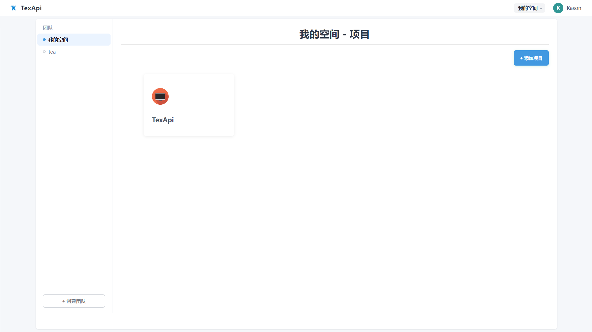
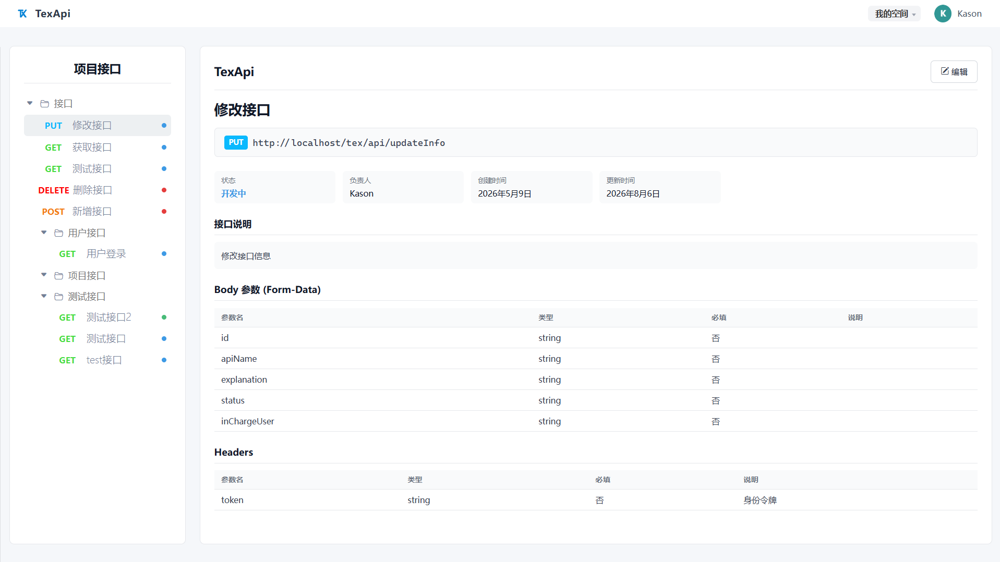
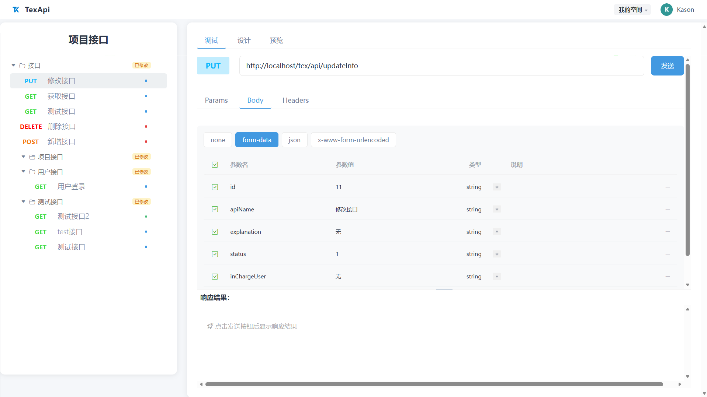

# TexApi — 轻量级接口管理协作平台

> 前后端分离的 API 管理工具，支持团队协作、接口录入、在线调试与文档导出。

---

## 📖 项目简介

TexApi 是一套**前后端分离**的接口在线管理平台。围绕「团队 → 项目 → 分类 → 接口」四级组织模型，提供从接口设计、在线调试到文档导出的完整闭环。

### 核心功能

| 模块      | 功能                                                |
| ------- | ------------------------------------------------- |
| 🔐 用户系统 | 注册 / 登录 / JWT 鉴权 / UUID 用户标识                      |
| 👥 团队协作 | 创建团队、邀请成员，四级角色权限（owner / admin / editor / viewer） |
| 📁 项目管理 | 项目归属团队，支持创建、编辑、删除                                 |
| 📂 分类树  | 分类按层级组织，草稿/发布双态管理                                 |
| 🔌 接口管理 | 支持 GET/POST/PUT/DELETE，多格式请求体，请求参数与响应模板           |
| 🧪 在线调试 | 浏览器端代理发送请求、查看响应                                   |
| 📄 文档导出 | 一键导出 HTML 离线文档                                    |
| ✏️ 草稿编辑 | 主表只读预览 + 草稿编辑模式，发布后同步到主表                          |

---

## 🏗️ 技术栈

### 后端

| 技术          | 版本   | 用途       |
| ----------- | ---- | -------- |
| Spring Boot | 3.4  | 基础框架     |
| MyBatis     | 3.0  | ORM 持久层  |
| MySQL       | 8.x  | 关系型数据库   |
| Redis       | 7.x  | 缓存       |
| JWT         | —    | 用户认证     |
| OkHttp      | 4.12 | 在线调试代理请求 |
| FastJSON2   | 2.0  | JSON 序列化 |
| Lombok      | 1.18 | 简化代码     |

### 前端

| 技术                        | 说明            |
| ------------------------- | ------------- |
| HTML5 / CSS3 / JavaScript | 原生实现，无框架依赖    |
| Axios                     | HTTP 请求库（CDN） |
| Nginx                     | 静态资源服务 + 反向代理 |

---

## 📁 项目结构

```
TexApi/
├── src/main/java/com/tex/texapi/
│   ├── common/                  # 公共模块（常量、上下文、异常、工具类）
│   ├── pojo/                    # 实体、DTO、VO
│   └── server/                  # 控制器、服务、Mapper、拦截器、切面
├── src/main/resources/
│   ├── mapper/                  # MyBatis XML 映射
│   ├── db/init/                 # 建库建表脚本
│   └── application*.yml         # 配置文件
├── nginx/html/tex/              # 前端
│   ├── index.html               # 登录页
│   ├── pages/                   # 页面（home / master / detail / team / user）
│   ├── components/              # 可复用组件（topBar / treeTable / modal / toast）
│   ├── api/                     # 前端 API 封装
│   └── css/                     # 样式
├── docker/                      # Docker 部署配置
└── .env.example                 # 环境变量模板
```

---

## 🚀 快速开始

### Docker 部署（推荐）

```bash
git clone https://gitee.com/kason-tang/tex-api.git
cd TexApi
cp .env.example .env          # 编辑设置密码
docker compose up -d           # 一键启动 server + MySQL + Redis + Nginx
```

访问 `http://localhost` 即可使用。

### 本地开发

环境要求：**JDK 17+**、**MySQL 8.0+**、**Redis 6.0+**

```bash
# 1. 初始化数据库
mysql -u root -p < src/main/resources/db/init/create_table.sql

# 2. 配置 application-dev.yml（数据库/Redis 连接信息）

# 3. 启动后端
./mvnw spring-boot:run

# 4. 启动前端（Nginx）
cd nginx && start nginx
```

---

## 🔌 API 概览

| 模块   | 路径前缀              | 说明                |
| ---- | ----------------- | ----------------- |
| 用户   | `/tex/user`       | 注册、登录、搜索          |
| 团队   | `/tex/team`       | 团队 CRUD、成员管理、角色变更 |
| 项目   | `/tex/project`    | 项目 CRUD           |
| 分类   | `/tex/categories` | 分类树管理、草稿发布        |
| 接口   | `/tex/api`        | 接口 CRUD、在线调试      |
| 请求参数 | `/tex/request`    | 请求参数管理            |
| 响应   | `/tex/response`   | 响应模板管理            |

---

## 🖥️ 页面截图

|                                        |                                      |
|:--------------------------------------:|:------------------------------------:|
| **登录**                                 | **主页（项目列表）**                         |
|             |            |
| **主表预览（只读浏览）**                         | **草稿编辑 & 在线调试**                      |
|  |  |

---

## 📄 License

MIT License · Copyright © 2026 Kason Tang
