# TexApi — 轻量级接口文档在线管理调试平台

> 前后端分离的轻量级 API 管理工具，支持接口录入、在线调试、文档导出，让团队协作更高效。

---

## 📖 项目简介

TexApi 是一套**前后端分离**的接口在线管理平台，专为后端开发人员设计。它解决了传统开发中接口文档分散、本地调试繁琐等问题，提供从接口录入 → 在线调试 → 导出离线文档的完整闭环。

### 核心功能

| 模块      | 功能说明                                           |
| ------- | ---------------------------------------------- |
| 🔐 用户系统 | 注册 / 登录 / JWT 鉴权，支持多用户协作                       |
| 📁 项目管理 | 创建项目、管理成员，按项目维度组织接口                            |
| 📂 分类管理 | 接口按分类层级组织，支持增删改查                               |
| 🔌 接口管理 | 录入接口（请求方式、URL、参数、响应体），支持 GET/POST/PUT/DELETE 等 |
| 🧪 在线调试 | 浏览器端直接发送请求、查看响应                   |
| 📄 文档导出 | 一键导出 HTML 离线文档，方便分享与归档                         |
| 📊 响应模板 | 预设 JSON 响应模板，快速复用                              |

---

## 🏗️ 技术栈

### 后端

| 技术          | 版本      | 用途              |
| ----------- | ------- | --------------- |
| Spring Boot | 3.4.3   | 基础框架            |
| Spring MVC  | —       | RESTful API     |
| MyBatis     | 3.0.5   | ORM 持久层         |
| MySQL       | 8.x     | 关系型数据库          |
| Redis       | 8.x     | 缓存 & Token 存储   |
| JWT         | —       | 用户认证与鉴权         |
| AspectJ     | 1.9.25  | AOP 日志切面        |
| FastJSON2   | 2.0.45  | JSON 序列化        |
| OkHttp      | 4.12.0  | HTTP 代理请求（在线调试） |
| Thymeleaf   | —       | 模板引擎（备用）        |
| Lombok      | 1.18.42 | 简化代码            |

### 前端

| 技术                             | 说明            |
| ------------------------------ | ------------- |
| HTML5 / CSS3 / JavaScript (原生) | 无框架依赖，纯原生实现   |
| Axios                          | HTTP 请求库（CDN） |
| Anime.js                       | 动画库（CDN）      |
| Nginx                          | 静态资源服务 & 反向代理 |

---

## 📁 项目结构

```
TexApi/
├── src/main/java/com/tex/texapi/
│   ├── common/                  # 公共模块
│   │   ├── constant/            # 常量
│   │   ├── context/             # 线程上下文（BaseContext）
│   │   ├── enumeration/         # 枚举
│   │   ├── exception/           # 全局异常处理
│   │   ├── properties/          # 配置属性类
│   │   ├── result/              # 统一响应体 Result<T>
│   │   └── utils/               # 工具类
│   ├── pojo/
│   │   ├── entity/              # 数据库实体
│   │   ├── dto/                 # 数据传输对象
│   │   └── vo/                  # 视图对象
│   └── server/
│       ├── annotation/          # 自定义注解
│       ├── aspect/              # AOP 切面
│       ├── config/              # Spring 配置
│       ├── controller/          # 控制器层
│       ├── handler/             # 处理器
│       ├── interceptor/         # 拦截器（JWT）
│       ├── mapper/              # MyBatis Mapper
│       └── service/             # 业务逻辑层
├── src/main/resources/
│   ├── mapper/                  # MyBatis XML 映射文件
│   └── application*.yml         # 配置文件
├── nginx/                       # Nginx 静态资源 & 反向代理
│   └── html/tex/                # 前端页面
│       ├── index.html           # 登录页
│       ├── index.js             # 登录页逻辑
│       ├── pages/               # 页面目录
│       │   ├── home/            # 项目主页
│       │   ├── detail/          # 接口详情页
│       │   └── registry/        # 注册页
│       ├── api/                 # 前端 API 封装
│       ├── components/          # 可复用组件
│       ├── config/              # 前端配置
│       ├── module/              # 功能模块
│       └── utils/               # 工具函数
└── redis/                       # Redis 配置
```

---

## 🚀 快速开始

### 方式一：Docker 部署（推荐）

> 无需安装 JDK、Maven、MySQL、Redis，只需 Docker。

```bash
# 1. 克隆项目
git clone https://gitee.com/kason-tang/tex-api.git
cd TexApi

# 2. 配置密码
cp .env.example .env
# 编辑 .env，设置 DB_PASSWORD 和 REDIS_PASSWORD

# 3. 一键启动
docker compose up -d
```

访问 `http://localhost` 即可使用。

<details>
<summary>📋 Docker 架构说明</summary>

| 服务 | 镜像 | 说明 |
|------|------|------|
| server | 本地构建（Dockerfile） | Spring Boot 后端，内置 Maven 编译 |
| db | mysql:8.0 | MySQL 数据库，自动建库建表 |
| redis | redis:7-alpine | Redis 缓存 |
| proxy | nginx:1.26-alpine | 静态资源 + 反向代理 |

首次启动会自动完成：拉取基础镜像 → Maven 编译打包 → 初始化数据库表结构，稍等几分钟即可。

</details>

---

### 方式二：本地开发部署

#### 环境要求

- **JDK** 17+
- **Maven** 3.6+
- **MySQL** 8.0+
- **Redis** 6.0+
- **Nginx**（可选，用于前端静态资源）

#### 1. 克隆项目

```bash
git clone https://gitee.com/kason-tang/tex-api.git
cd TexApi
```

#### 2. 初始化数据库

执行 `src/main/resources/db/init/create_table.sql` 脚本即可完成建库建表：

```bash
mysql -u root -p < src/main/resources/db/init/create_table.sql
```

该脚本会自动创建 `tex_api` 数据库及所有表结构（`user`、`project`、`project_user`、`category`、`api`、`request_params`、`response`）。

#### 3. 配置环境

编辑 `src/main/resources/application-dev.yml`，修改为你的本地环境：

```yaml
tex:
  driver-class-name: com.mysql.cj.jdbc.Driver
  username: root
  password: your_password
  datasource:
    host: localhost
    port: 3306
    database: tex_api
  redis:
    host: localhost
    port: 6379
    password: your_redis_password
    database: 9
```

#### 4. 启动后端

```bash
mvn clean package -DskipTests
mvn spring-boot:run
```

后端服务默认运行在 `http://localhost:8080`。

#### 5. 启动前端（Nginx）

将 `nginx/html/tex/` 配置为 Nginx 静态资源目录，并启动 Nginx：

```bash
cd nginx/nginx-1.26.3
start nginx
```

前端默认运行在 `http://localhost/tex/`。

---

## 🔌 API 概览

| 模块   | 路径前缀                 | 说明           |
| ---- | -------------------- | ------------ |
| 用户   | `/tex/user`          | 注册、登录        |
| 项目   | `/tex/project`       | 项目 CRUD、成员管理 |
| 分类   | `/tex/category`      | 接口分类管理       |
| 接口   | `/tex/api`           | 接口录入、在线调试    |
| 请求参数 | `/tex/requestParams` | 接口请求参数管理     |
| 响应模板 | `/tex/response`      | 响应体模板管理      |

---

## 🖥️ 页面截图

### 🔐 登录 & 注册

| 登录                            | 注册                            |
|:-----------------------------:|:-----------------------------:|
| 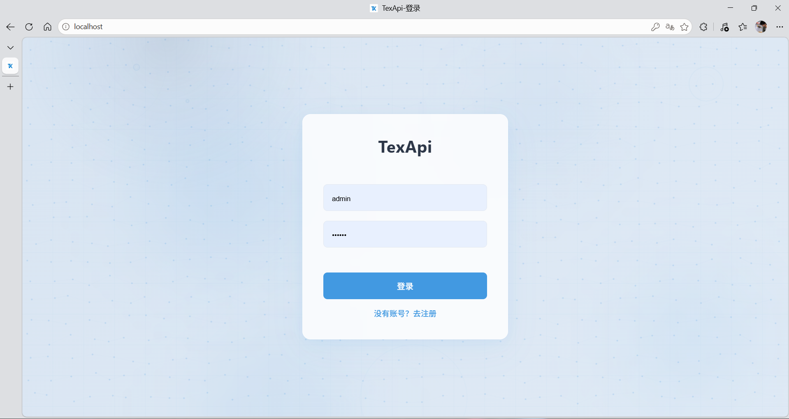 | 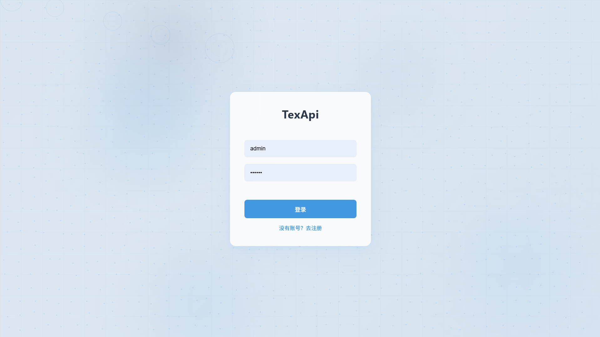 |

### 📁 项目管理

| 项目主页                                  | 新建项目                                  |
|:-------------------------------------:|:-------------------------------------:|
| 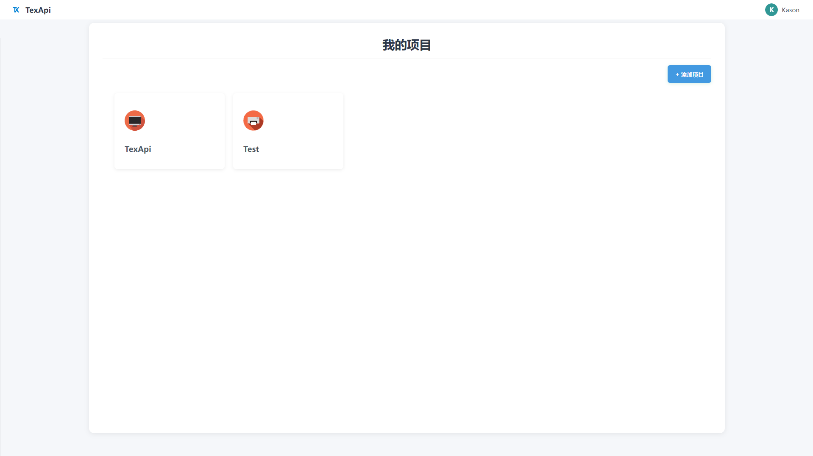 | 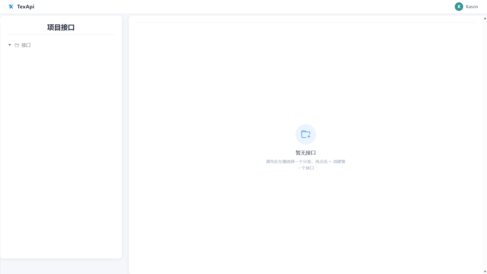 |

### 🎨 接口设计

| 基本信息                                      | 参数设计                                      | 
|:-----------------------------------------:|:-------------------------------------------:|
| 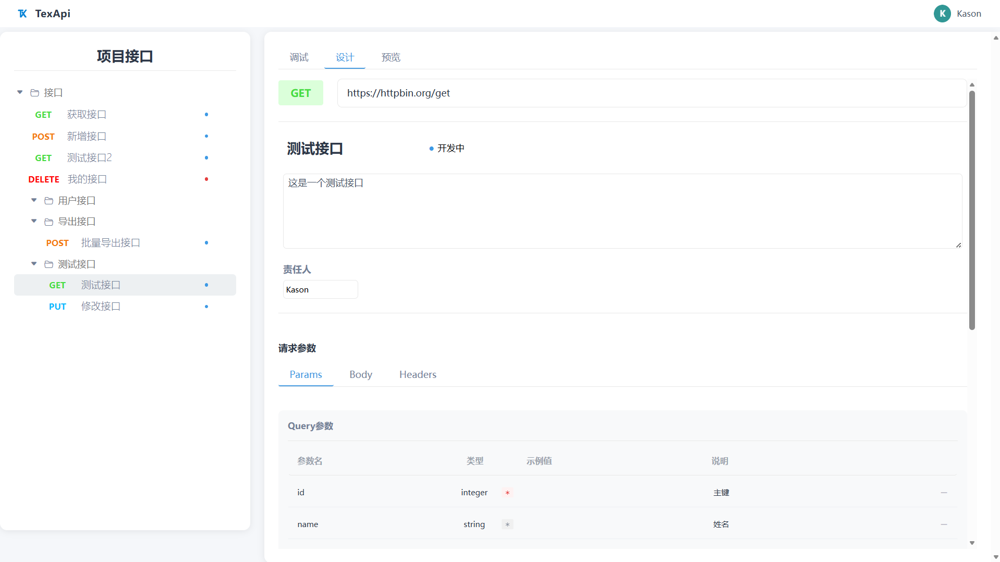 | 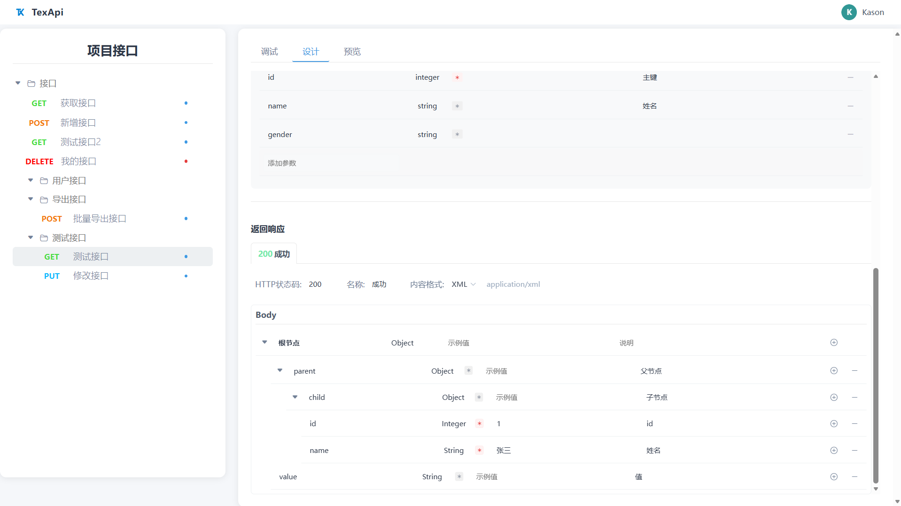                        |

### 🧪 在线调试

| 调试面板                                  | 请求响应                                        |
|:-------------------------------------:|:-------------------------------------------:|
| 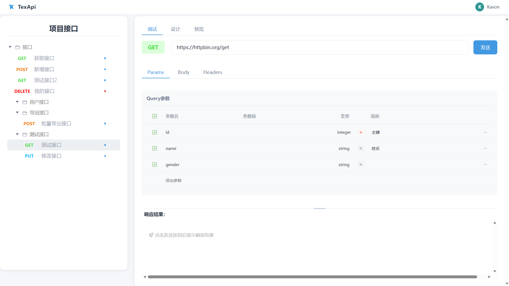 | 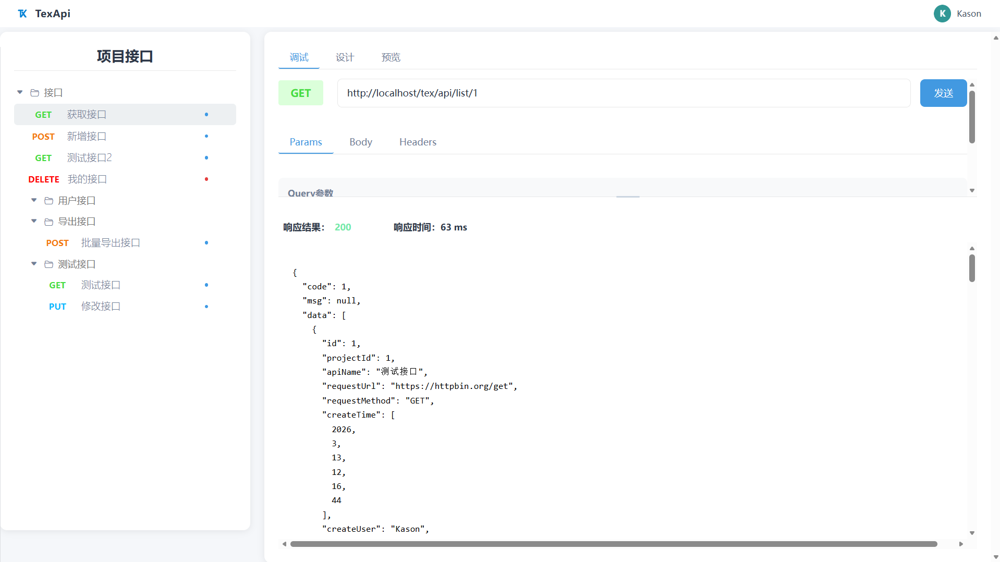 |

### 👁️ 接口预览

| 预览视图-1                            | 预览视图-2                            |
|:---------------------------------:|:---------------------------------:|
| 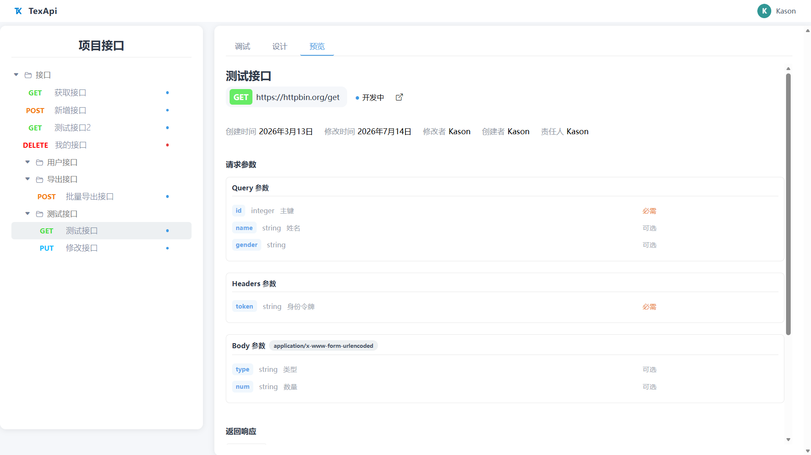 | 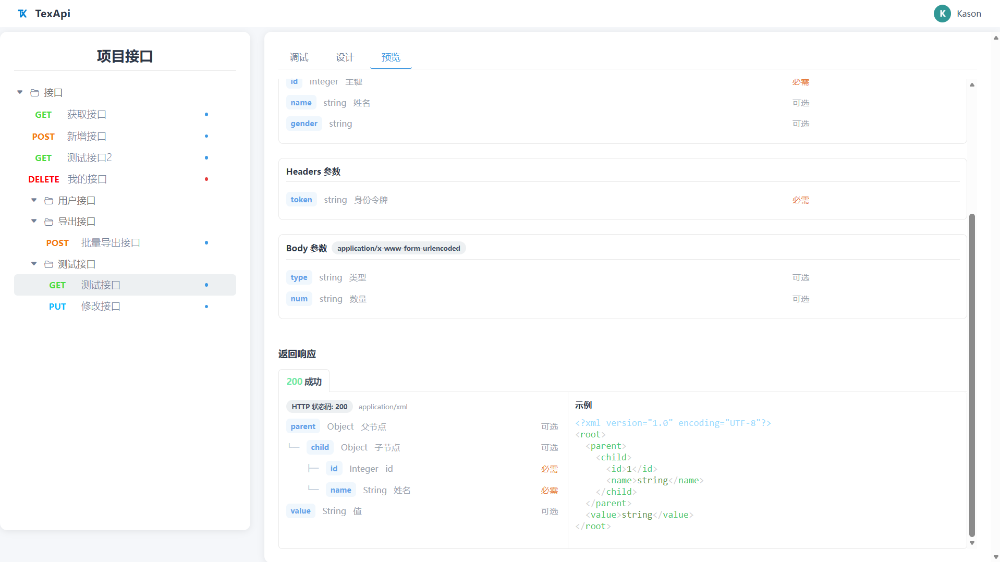 |

### 📄 导出文档

<p align="center">
  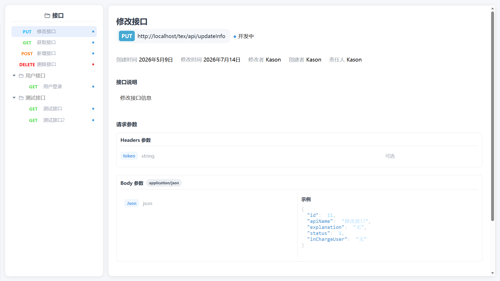
</p>

> 📎 导出效果示例：[浏览器打开文件查看离线 HTML 文档](assets/html/接口.html)

---

## 🤝 参与贡献

1. Fork 本仓库
2. 新建分支：`git checkout -b feat/your-feature`
3. 提交代码：`git commit -m 'feat: 添加某某功能'`
4. 推送分支：`git push origin feat/your-feature`
5. 创建 Pull Request

---

## 📄 License

本项目基于 [MIT License](LICENSE) 开源，Copyright © 2026 Kason Tang。